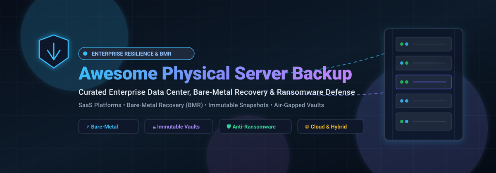

  

# 🛡️ Awesome Data Center & Physical Server Backup

  
  
  
  
  
  

> **A curated, comprehensive guide to Enterprise Data Center Backup, Bare-Metal Recovery (BMR), Immutable Cloud Storage, Deduplication Appliances, and Ransomware-Resilient Business Continuity Solutions.**

---

## 📌 Executive Summary & Key Highlights

This repository tracks top-tier **enterprise SaaS platforms** and **open-source data protection engines** engineered for physical bare-metal servers, virtual machine hypervisors, and data center infrastructure. Whether architecting zero-trust disaster recovery pipelines, meeting strict RTO/RPO SLAs, deploying immutable air-gapped snapshots, or configuring hardware-independent bare-metal restoration, this directory offers verified pricing structures, free trial limits, valuation metrics, and source-code links.

* **Target Audiences:** Data Center Architects, Infrastructure Engineers, Systems Administrators, Site Reliability Engineers (SREs), Enterprise Storage Specialists, and CISO SecOps teams.
* **Core Disciplines:** Bare-Metal Recovery (BMR), Immutable Storage, Block-Level Deduplication, Air-Gapped Cyber Vaults, Volume Snapshotting, and Disaster Recovery as a Service (DRaaS).

---

## 📈 Sector Overview & Market Dynamics

The global enterprise backup and data recovery software sector is valued at approximately **$11B to $18B** (scaling past **$35B+** when including integrated physical appliances, disaster recovery solutions, and DRaaS), expanding at a compound annual growth rate (CAGR) of **7%–11%** through 2026. This acceleration is propelled by ransomware resilience requirements, air-gapped immutability mandates, and multi-cloud workload protection.

The market landscape is **moderately fragmented yet aggressively consolidating**: while thousands of regional MSPs and specialized point solutions serve niche and departmental workloads, core enterprise data center market share is increasingly concentrated around a handful of dominant balance sheets and merged platforms (such as Veeam, Dell, Cohesity/Veritas, Rubrik, and Commvault).

---

## 📑 Table of Contents

- [📌 Executive Summary & Key Highlights](#-executive-summary--key-highlights)
- [📈 Sector Overview & Market Dynamics](#-sector-overview--market-dynamics)
- [🏢 Enterprise SaaS & Hosted Platforms](#-enterprise-saas--hosted-platforms)
- [💻 Open-Source GitHub Projects](#-open-source-github-projects)
- [🤝 How to Contribute](#-how-to-contribute)
- [⭐ Star History](#-star-history)
- [☕ Support & Sponsorship](#-support--sponsorship)
- [⚠️ Disclaimer](#️-disclaimer)

---

## 🏢 Enterprise SaaS & Hosted Platforms

Enterprise platforms delivering hardware-agnostic image backup, automated disaster orchestration, air-gapped ransomware protection vaults, and bare-metal recovery across heterogeneous operating environments.

| 🏢 Product | 💰 Company Scale (Valuation / Revenue) | 📝 Description | 🏷️ Starting Pricing Tier | 🎁 Free Tier / Trial Limits |
|:---|:---|:---|:---|:---|
| **[IBM Spectrum Protect](https://www.ibm.com/)** | **~$235B Market Cap** (~$69.9B Annual Rev) | Enterprise backup and recovery for physical and virtual environments (formerly Tivoli Storage Manager / TSM). | **$900/year per Front-End TB** subscription ($5,720.10/year for 1–100 TB Suite via GSA) | **30-day free trial** with full feature access via IBM Marketplace/Azure |
| **[Dell PowerProtect](https://www.dell.com/)** | **~$205B Market Cap** (~$151.2B Annual Rev) | Hardware appliance & software suite (PowerProtect DD / Data Manager) for backup, deduplication, and cyber recovery. | **~$1,800/year** (software entry license; appliances from ~$10,000) | **90-day free trial** built-in evaluation license with full platform functionality |
| **[HPE StoreOnce](https://www.hpe.com/)** | **~$63B Market Cap** (~$41.9B Annual Rev) | Deduplication backup appliance and StoreOnce VSA (Virtual Storage Appliance) with Cloud Bank storage. | **~$1,500 base license + ~$450/TB** for StoreOnce VSA (Physical systems from $76,142) | **90-day free trial** ("instant-on" demo license supporting up to 500 TB; excludes encryption/Pointnext support) |
| **[Rubrik Cloud Vault](https://www.rubrik.com/)** | **~$15.5B Market Cap** (~$1.54B Annual Rev) | Zero-trust data security and cyber resilience platform with immutable backups and anomaly detection. | **$14/month per TB** (Foundation tier; Advanced tier at $24/month per TB) | **30-day free trial** (partner/sales-provisioned; capped at 500 users / 10 TB for M365 or 10 users / 500 GB for Google Workspace) |
| **[Veeam Backup & Replication](https://www.veeam.com/)** | **$15.0B Valuation** (~$1.7B+ ARR) | Industry-standard backup for virtual, physical, cloud, and Kubernetes workloads with bare-metal restore. | **$428/year per 5 instances** (Veeam Data Platform Essentials) | **Community Edition: Free forever** up to 10 workloads; **30-day free trial** for full Enterprise Plus |
| **[Cohesity DataProtect](https://www.cohesity.com/)** | **~$7.5B Valuation** (~$1.7B Combined Rev) | AI-powered data protection with immutable snapshots and cyber vaulting (merged with Veritas data protection). | **$29,100/year** (starting baseline 10 TB capacity block on AWS Marketplace) | **30-day free trial** for DataProtect as a Service (DPaaS) via marketplace/sales |
| **[Commvault Complete Data Protection](https://www.commvault.com/)** | **~$5.5B Market Cap** (~$900M Annual Rev) | Enterprise cyber-resilience with immutable backups, autonomous recovery, and Cleanroom recovery. | **$120/year per client/workload** (~$10/month starting baseline) | **30-day free trial** for Commvault Cloud SaaS workloads with full feature set |
| **[Acronis Cyber Protect](https://www.acronis.com/)** | **~$3.5B Valuation** (~$400M Annual Rev) | Cyber protection combining image-level server backup, disaster recovery, and AI-based ransomware detection. | **$85/year** (Standard Server single physical server license) | **30-day free trial** (Standard/Advanced features with 1 TB trial cloud storage; WinPE restore restricted in trial) |
| **[Druva Data Security Cloud](https://www.druva.com/)** | **~$620M Valuation** (~$200M+ SaaS ARR) | 100% SaaS data protection platform with 100% agentless cloud backup, global deduplication, and automated DR. | **$2.50/month per user** (M365) or **€191/TB/month** (Enterprise server data) | **30-day free trial** (extendable to 60 days via managed partner evaluation; no credit card required) |

---

## 💻 Open-Source GitHub Projects

Active open-source backup platforms, self-hosted disaster recovery utilities, bare-metal recovery toolkits, and deduplication archivers. Sorted by GitHub community stargazers count.

| 💻 Repository | ⭐ Star Badge | 📝 Architecture & Description |
|:---|:---:|:---|
| **[Restic](https://github.com/restic/restic)** |  | Fast, secure, deduplicated backup program written in Go. Supports local, SFTP, REST, and multi-cloud object storage (S3, B2, Azure, GCS) with client-side cryptography. |
| **[Duplicati](https://github.com/duplicati/duplicati)** |  | Block-based encrypted backup client with built-in web management interface, AES-256 encryption, and scheduling for physical servers and workstations. |
| **[Kopia](https://github.com/kopia/kopia)** |  | Cross-platform fast backup engine with client-side deduplication, compression, end-to-end encryption, snapshot repository server mode, and both CLI and GUI. |
| **[BorgBackup](https://github.com/borgbackup/borg)** |  | Enterprise-grade deduplicating archiver with authenticated encryption and LZ4/ZSTD compression. The definitive Linux physical server file-level backup tool. |
| **[Velero](https://github.com/vmware-tanzu/velero)** |  | Cloud-native Kubernetes disaster recovery tool for backing up, restoring, and migrating cluster resources and persistent storage volumes across bare-metal and cloud clusters. |
| **[Bup](https://github.com/bup/bup)** |  | Highly efficient rolling-checksum backup system built on the Git packfile format, engineered specifically for large files, disk images, and virtual machine raw drives. |
| **[Rustic](https://github.com/rustic-rs/rustic)** |  | High-performance, memory-safe backup client and library written in Rust, fully compatible with Restic repositories with multithreaded processing and cold storage optimizations. |
| **[Barman](https://github.com/EnterpriseDB/barman)** |  | Backup and Recovery Manager for PostgreSQL servers in production data centers. Delivers zero-data-loss Point-In-Time-Recovery (PITR) and remote backup cataloging. |
| **[Borgmatic](https://github.com/borgmatic-collective/borgmatic)** |  | Simple, declarative configuration-driven wrapper for BorgBackup with integrated hooks for databases (PostgreSQL, MySQL, SQLite), healthcheck monitoring, and retention policies. |
| **[Autorestic](https://github.com/cupcakearmy/autorestic)** |  | Declarative CLI wrapper for Restic that orchestrates multi-location backups, automated cron-like scheduling, and health alert webhooks from single YAML configs. |
| **[Casync](https://github.com/systemd/casync)** |  | Content-addressable data synchronization tool designed by systemd creator Lennart Poettering for efficient transport and differential storage of file systems and raw disk images. |
| **[Bareos](https://github.com/bareos/bareos)** |  | Open-source enterprise network backup and restore suite (Bacula fork) supporting tape libraries, disk storage, NDMP, multi-OS clients, and automated enterprise scheduling. |
| **[ReaR (Relax-and-Recover)](https://github.com/rear/rear)** |  | Leading open-source bare-metal disaster recovery and system migration tool for Linux. Generates bootable rescue media that restores bare-metal servers to dissimilar physical hardware. |
| **[UrBackup](https://github.com/uroni/urbackup_backend)** |  | Client/server backup system for Windows and Linux featuring live image-level backups (bare-metal restore via live CD), file backups, VSS snapshot integration, and web administration. |
| **[Burp](https://github.com/grke/burp)** |  | Network backup and restore system utilizing librsync and differential algorithms to deliver reliable, network-efficient snapshots of networked servers and clients. |
| **[Elkarbackup](https://github.com/elkarbackup/elkarbackup)** |  | Open-source centralized backup solution based on Rsnapshot/Rsync with a multilingual web management GUI, pre/post execution scripts, and granular backup scheduling. |
| **[Bacula-Web](https://github.com/bacula-web/bacula-web)** |  | Open-source responsive web-based reporting and monitoring dashboard for Bacula infrastructure, visualizing backup jobs, catalog health, storage pools, and volume usage. |

---

## 🤝 How to Contribute

We welcome community contributions, architectural additions, and up-to-date pricing disclosures!

1. 🍴 **Fork the repository** on GitHub.
2. 🌿 **Create a descriptive feature branch** (`git checkout -b feature/add-new-backup-tool`).
3. 📝 **Add/Update entries in `README.md`** adhering to the existing tabular format:
   - Ensure tool name, valid official link, and concise 1–2 sentence architectural description.
   - For SaaS additions, provide validated starting tier pricing and specific trial/free-forever terms.
   - For Open-Source additions, supply the repository path and ensure the star badge points to its stargazers page.
4. 🚀 **Submit a Pull Request** with a brief summary of the changes and sources for pricing or benchmark claims.

---

## ⭐ Star History

---

## ☕ Support & Sponsorship

Thank you for exploring and utilizing this curated directory! If you find this resource valuable for your data center operations, infrastructure architecture, or disaster recovery planning, please consider showing your support:

- ⭐ **Star this repository** to improve discoverability for other systems engineers.
- 🍴 **Fork and share** with colleagues, devops communities, and storage groups.
- ☕ **Buy me a coffee / Sponsor the project:** Support ongoing maintenance, updates, and open-source curation via the [GitHub Sponsors Dashboard](https://github.com/sponsors/ishandutta2007).

Your backing ensures this knowledge base remains free, transparent, and continuously updated with vetted data!

---

## ⚠️ Disclaimer

- This is an **independently curated community list** compiled for research, education, and architectural evaluation; it does not constitute an official commercial endorsement.
- Backup platforms protect mission-critical business and institutional workloads; always enforce end-to-end encryption at rest and in transit, air-gapped or immutable snapshots for ransomware resilience, and regular automated restore drill tests.
- **Physical server bare-metal recovery represents one of the most demanding infrastructure failure modes.** Commercial solutions (Veeam, Acronis, Commvault, Rubrik) provide hardware-agnostic image restoration across heterogeneous architectures and Windows/Linux environments. Open-source **ReaR** facilitates Linux bare-metal recovery but requires disciplined testing on target hardware profiles.

---

  <b>Built with ❤️ for backup administrators, infrastructure engineers, SREs, and IT resilience teams worldwide.</b>

